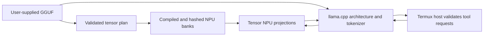

# PixelForge

I built PixelForge to compile my own model weights for the Tensor NPU on my
phone. The point is a complete path I can inspect: the source weights, the
matrix plan, the compiled code, the runtime calls and the result.

PixelForge uses llama.cpp for the model architecture and tokenizer. It lowers
declared weight projections into device-specific DarwiNN code and invokes that
code through the Android Tensor runtime. Attention, normalization, sampling
and projections assigned to the CPU retain their native model operations.
For a projection `Y = XWᵀ`, placement identifies where the operation runs;
the artifact records which weights and precision produced it.



## What works

The current phone configuration runs **Huihui NeoHorse 1 4B** through the
`c` voice/chat interface with explicit CPU/NPU placement. Three feed-forward
projections in its first block execute on the NPU. The remaining projections,
prompt processing, attention, normalization and sampling execute on CPU.
This is a hybrid model execution path.

A live test asked the model to read a file. It emitted a complete tool request,
received the actual host result and returned the exact file contents. The two
model turns made **72 NPU weight operations and 168 native NPU invocations**,
loaded seven saved banks and compiled nothing during inference. Cleanup passed.
The whole test took **214.6 seconds**. That establishes this tool loop and its
hardware path; broader quality and performance need separate measurement.

Huihui Gemma 4 E2B also passed an arithmetic check with all planned dense
decoding projections assigned to the NPU and CPU prompt processing. One NPU
decoding step ran during a **62.3-second generation call**, including CPU prompt
processing. The NeoHorse hybrid is the selected profile.

Selected NPU operations fail closed. Their errors end generation rather than
replaying it through another model. Main turns have no elapsed deadline;
`/cancel` ends the owned inference process. The ordinary Termux host validates
and executes tools under the saved action policy. The privileged inference
entrypoint accepts model input, not shell commands.

Read [the evidence and its limits](docs/VALIDATION.md).
The fresh public source build and isolated installer independently passed the
same kind of file-tool task, with 66 NPU matrix operations and 154 native
invocations. That run took 707.9 seconds under concurrent phone load.

## Build and use

The tested hardware is a **rooted Pixel 10 Pro with Tensor G5**. The device
compiler path needs the matching vendor runtime and an existing Ubuntu ARM64
environment. Compiled banks are bound to their source model, graph recipe and
device/compiler fingerprint. Other hardware requires its own validation.

Start with the [GGUF compiler guide](tools/arm_npu/GGUF_COMPILER.md). It covers
inspection, disk planning, selected-bank compilation, resume and read-only
execution. Supply the weights and device runtime separately.

Build the conversational decoder from pinned upstream source:

```sh
python3 -m venv chat/venv
chat/venv/bin/python -m pip install -r chat/requirements-chat.txt
bash chat/build_native.sh --fetch
chat/venv/bin/python chat/install.py --help
```

`--fetch` retrieves the pinned llama.cpp source revision. The installer prints
its plan by default. Follow [the chat guide](chat/README.md) to provide the local
model, compiled banks, native helper, Ubuntu environment and Termux paths.
Weights and banks are referenced in place.

Install the source shortcut from ordinary Termux:

```sh
python3 source/ostadix-voice/install_shortcut.py --shell both
c --text
```

Inside `c`, `/engine pixelforge` saves the selection. `/status` shows the model
and placement; `/cancel` interrupts a turn; `/quit` closes the interface.
Use `/voice on` when the Android speech bridge is installed and you want
microphone capture. See [the voice source guide](source/README.md).

## Scope

The compiler plans supported rank-two weight matrices. Architecture recognition
and matrix compilation are separate from successful model generation. Indexed
expert operations, split GGUF assembly and unsupported quantizations are
reported explicitly. Requantizing selected projections to int8 can change
outputs; each model and placement needs a reference check.

The optional [Ostadix adapter](integrations/ostadix/README.md) exposes compiler
operations through an O program. Its source and build recipe are included.
The old embedded binary is outside this source release.

## Verify and package

```sh
sh setup.sh verify
python3 -m unittest discover -s tests -p 'test_*.py'
chat/venv/bin/python -m unittest discover -s chat/tests -p 'test_*.py'
sh setup.sh pack-source --output /fresh/path/pixelforge-source.tar.gz
```

The public archive uses an explicit source boundary and a hash manifest. Model
weights, compiled banks, vendor binaries, credentials, signing material, phone
settings, sessions and private backups stay outside it. Earlier restoration
utilities and device-bundle history are excluded from this source distribution.

## Author and license

**Lee Daghlar Ostadi** · [lostadi](https://github.com/lostadi)

Original PixelForge code and documentation are **LGPL-2.1-only**. Upstream code
retains its existing notices and licenses. See [LICENSE](LICENSE),
[NOTICE](NOTICE) and [third-party provenance](THIRD_PARTY_NOTICES.md).
