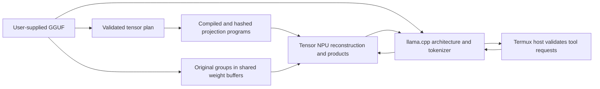

# PixelForge

I built PixelForge to compile my own model weights for the Tensor NPU on my
phone. The point is a complete path I can inspect: the source weights, the
matrix plan, the compiled code, the runtime calls and the result.

PixelForge uses llama.cpp for the model architecture and tokenizer. A declared
tensor plan selects projections for device-specific DarwiNN programs. In the
original-group routes, compiled code describes the geometry and the original
GGUF integer levels and coefficients become weight inputs. The Tensor NPU
reconstructs those weights and computes `Y = XWᵀ`. The source plan, graph
recipe and device fingerprint identify each program. Attention, recurrent GDN,
normalization, sampling and projections assigned to the CPU retain their native
model operations. The diagram shows that original-group path.



## What works

The **Huihui NeoHorse 1 4B** path has run its 249 main Q5_K/Q6_K projections
on NPU during both prompt processing and decoding. The `original_groups`
route retains the original integer levels and coefficients, reconstructs
weights on NPU and shares DMA weight buffers between B16 prompt programs
and B1 decode programs. The GGUF stays unchanged and no extra quantization
is introduced. Attention, recurrent GDN, normalization, sampling and ordinary
FFN elementwise operations remain on CPU. Read the
[original-group execution guide](tools/arm_npu/ORIGINAL_GROUPS.md).

The opt-in `original_columns` family takes successive logical ranges of 3072
columns and zero-pads only a shorter split tail to that physical program width.
An unsplit matrix of at most 3072 columns keeps its original width. NPU programs
produce the partial products; the host adds them in order using F32 arithmetic.
It keeps the same original GGUF and quantized groups. B64 is usable only after
every required row, column and batch geometry passes device validation.
Individual primitive checks establish their tested geometries. The later
ordinary-app tool test below establishes the specific full B64 conversation
path; broader performance and quality remain separate measurements.

The v0.2.0 path completed a real file-tool task through ordinary Termux
in its normal SELinux application domain. The model chose a workspace read,
received the actual result and returned the requested value on its second
turn. Both turns selected all 249 main projections for NPU prompt processing
and decoding, with zero CPU-placed weight operations. The second turn reused
512 prefix tokens. The test took **1007.335 seconds, about 17 minutes**, with
a resident-program limit of two. It is slow and does not establish a CPU
speedup. Preserving original weight groups also does not make vendor float
arithmetic bit-identical to CPU execution. Read
[the measured limits and tested profile](docs/VALIDATION.md).

A prior three-projection hybrid test asked the model to read a file. It emitted a complete tool request,
received the actual host result and returned the exact file contents. The two
model turns made **72 NPU weight operations and 168 native NPU invocations**,
loaded seven saved banks and compiled nothing during inference. Cleanup passed.
The whole test took **214.6 seconds**. That establishes this tool loop and its
hardware path; broader quality and performance need separate measurement.

Huihui Gemma 4 E2B also passed an arithmetic check with all planned dense
decoding projections assigned to the NPU and CPU prompt processing. One NPU
decoding step ran during a **62.3-second generation call**, including CPU prompt
processing. These historical checks used separate bank recipes and placements.

Selected NPU operations fail closed. Their errors end generation rather than
replaying it through another model. Main turns have no elapsed deadline;
`/cancel` ends the owned inference process. The ordinary Termux host validates
and executes tools under the saved action policy. The privileged inference
entrypoint accepts model input, not shell commands.

Read [the evidence and its limits](docs/VALIDATION.md).
The fresh public source build and isolated installer independently passed the
same kind of file-tool task, with 66 NPU matrix operations and 154 native
invocations. That run took 707.9 seconds under concurrent phone load.

## Register compiled GGUFs in Voice

Ostadix Voice can select registered decoder GGUFs from any publisher. Each
registration binds the original model hash to its compiled package, probes the
actual native loader/tokenizer and verifies the declared NPU banks before
activation. An exact package leaf supplies the recipe, dtype and batch layout;
routes supporting split batches use a compatible B1 sibling for decoding when
present. Float32 dynamic-input programs retain one batch for both phases.
Templates use actual model special tokens; models without templates use explicit
raw completion.

On an existing platform installation, `chat/install.py --from-compiled`
registers an exact package leaf with `--model-id ID`; `--select --apply` selects
it. Compiler CLIs can request the handoff after successful compilation with
`--voice-model-id ID` and optional `--select-voice`. In ordinary Termux,
`/models` lists registered models and `/engine pixelforge ID` selects one while idle. Read the
[registration workflow and limits](chat/README.md#register-a-compiled-package).
A matrix-only result, unsupported model or missing declared bank is rejected;
registration does not establish general conversation quality or NPU numerical
validation. Normal CPU graph operations remain, and failed declared NPU work
does not switch automatically to CPU or cloud inference.

## Build and use

The tested hardware is a **rooted Pixel 10 Pro with Tensor G5**. The device
compiler path needs the matching vendor runtime and an existing Ubuntu ARM64
environment. Compiled banks are bound to their source model, graph recipe and
device/compiler fingerprint. Other hardware requires its own validation.

Start with the [GGUF compiler guide](tools/arm_npu/GGUF_COMPILER.md). It covers
inspection, disk planning, selected-bank compilation, resume and read-only
execution. Supply the weights and device runtime separately.

Build the conversational decoder from pinned upstream source:

```sh
python3 -m venv chat/venv
chat/venv/bin/python -m pip install -r chat/requirements-chat.txt
bash chat/build_native.sh --fetch
chat/venv/bin/python chat/install.py --help
```

`--fetch` retrieves the pinned llama.cpp source revision. The installer prints
its plan by default. Follow [the chat guide](chat/README.md) to provide the local
model, compiled banks, native helper, Ubuntu environment and Termux paths.
Weights and banks are referenced in place.

The optional prefix cache retains exact prompt-token checkpoints, including
attention and recurrent GDN state, in bounded RAM. It is off by default;
`--prefix-cache-mib 256` is an explicit phone-profile option. A failed restore
clears the cache and starts fresh prompt processing. Ready and completion
receipts report the configured budget and actual reused tokens. The cache
does not add an elapsed turn deadline or replay host actions.

`--cpu-affinity` optionally limits this inference service and its children to
an allowed CPU mask. Shared weight caching retains admitted buffers and streams
the overflow tail; memory pressure can evict this process's retained entries.
These settings change neither the GGUF nor Android's global clock, thermal or
scheduling policy. See [the chat settings](chat/README.md).

Install the source shortcut from ordinary Termux:

```sh
python3 source/ostadix-voice/install_shortcut.py --shell both
c --text
```

Inside `c`, `/models` lists registered models; `/engine pixelforge ID` selects
one while idle. `/engine pixelforge` uses the selected model. `/status` shows its
identity and placement; `/cancel` interrupts a turn; `/quit` closes the interface.
Use `/voice on` when the Android speech bridge is installed and you want
microphone capture. See [the voice source guide](source/README.md).

## Scope

The compiler plans supported rank-two weight matrices. Architecture recognition
and matrix compilation are separate from successful model generation. Indexed
expert operations, split GGUF assembly and unsupported quantizations are
reported explicitly. The original-group route supports exact Q5_K/Q6_K
layouts; other formats need a separate validated route. Legacy static INT8
constants requantize decoded weights and can change outputs. Each model and
placement needs a reference check, including vendor arithmetic precision.

The optional [Ostadix adapter](integrations/ostadix/README.md) exposes compiler
operations through an O program. Its source and build recipe are included.
The old embedded binary is outside this source release.

## Verify and package

```sh
sh setup.sh verify
python3 -m unittest discover -s tests -p 'test_*.py'
chat/venv/bin/python -m unittest discover -s chat/tests -p 'test_*.py'
sh setup.sh pack-source --output /fresh/path/pixelforge-source.tar.gz
```

The public archive uses an explicit source boundary and a hash manifest. Model
weights, compiled banks, vendor binaries, credentials, signing material, phone
settings, sessions and private backups stay outside it. Earlier restoration
utilities and device-bundle history are excluded from this source distribution.

## Author and license

**Lee Daghlar Ostadi** · [lostadi](https://github.com/lostadi)

Original PixelForge code and documentation are **LGPL-2.1-only**. Upstream code
retains its existing notices and licenses. See [LICENSE](LICENSE),
[NOTICE](NOTICE) and [third-party provenance](THIRD_PARTY_NOTICES.md).
